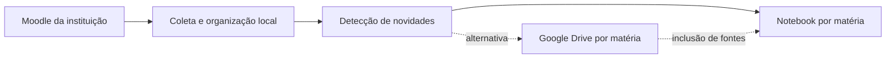

# Moodle Study Sync

Aplicativo experimental para organizar materiais do Moodle por matéria e semestre e manter um notebook correspondente no **Google Gemini Notebook (antigo NotebookLM)**. Integra [Moodle-DL](https://github.com/C0D3D3V/Moodle-DL) e [notebooklm-py](https://github.com/teng-lin/notebooklm-py), com créditos e licenças em [THIRD_PARTY_NOTICES.md](THIRD_PARTY_NOTICES.md).

**Piloto local: seis matérias e dez salas. O app tem tema escuro, recibos de envio e rotina diária às 23h. Recursos com vários arquivos são identificados separadamente, incluindo exercícios e gabarito. Formatos de laboratório sem suporte permanecem na biblioteca local. A instalação inicial em outro computador ainda requer preparação técnica.**

## App local

Abra **Meus Estudos** pelo atalho da área de trabalho ou por `Meus-Estudos.cmd`. A biblioteca usa tema escuro e permite adicionar matérias, escolher semestres, reunir teoria e prática no mesmo notebook, pausar a rotina e renovar os acessos. Veja [como usar o app](docs/APP.md).

A configuração atual reúne seis matérias em dez salas do Moodle. Os materiais são organizados localmente; formatos de laboratório sem suporte ficam na pasta e são identificados no painel. PDFs digitalizados podem usar texto reconhecido localmente. Plantas de uma página recusadas como PDF podem ser enviadas como imagem, preservando o original e o recibo da conversão.

## Fluxo de uso

1. Entrar no Moodle da instituição pelo fluxo autorizado.
2. Escolher as matérias e conferir os nomes.
3. Ver uma prévia dos materiais encontrados e dos destinos.
4. Baixar os arquivos por matéria e unidade/aula.
5. Enviar as fontes para um notebook com o mesmo nome da matéria.
6. Nas próximas execuções, tratar apenas novidades e alterações, com um relatório simples.

O envio pelo Drive é uma alternativa de integração. Criar uma pasta ou colocar arquivos nela não significa que todas as fontes foram adicionadas ao notebook.

## Por onde começar

| Documento | Conteúdo |
|---|---|
| [Escopo](docs/ESCOPO.md) | Objetivo, primeira versão e critérios de sucesso |
| [Pesquisa](docs/PESQUISA.md) | APIs, projetos existentes e decisão de reaproveitamento |
| [Arquitetura](docs/ARQUITETURA.md) | Organização, sincronização, recuperação e credenciais |
| [Plano de entregas](docs/ROADMAP.md) | Piloto, tarefas e condições para avançar |
| [Planejador local](docs/PLANEJADOR.md) | Código executável, decisões locais e limites atuais |
| [Coletor Moodle-DL](docs/MOODLE-DL.md) | Instalação, autenticação privada e teste de repetição |
| [Rotina automática](docs/ROTINA.md) | Configuração executável, envio, recuperação e agendamento |
| [Contribuição](CONTRIBUTING.md) | Preparação para colaboração pública |
| [Segurança](SECURITY.md) | Separação entre código, materiais e acesso às contas |

O programa atual lê `private/app-settings.json`, mantido pelo app. Se esse cadastro ainda não existe, importa `sync.local.toml`, baseado em [sync.example.toml](sync.example.toml). O arquivo `config.example.toml` registra o desenho inicial mais amplo; ainda não é consumido. Configurações locais e inventários são ignorados pelo Git.

## Direção inicial

O Moodle-DL coleta os materiais da matéria selecionada. O importador descobre recursos novos, organiza os arquivos por aula e preserva versões. O conector `notebooklm-py` envia arquivos, espera o processamento e registra o notebook, ID e hash. Cinco fontes do piloto foram preservadas e 30 foram enviadas pelo programa, incluindo DOCX. A repetição consultou o Google ao vivo e não repetiu uploads.

A execução é independente do Codex. O computador precisa estar ligado, conectado e com a sessão do Windows aberta. Sessões vencidas e mudanças nas interfaces não oficiais podem exigir intervenção. A rotina coleta uma vez todas as salas ativas e atualiza cada notebook. Conteúdos idênticos em teoria e prática compartilham uma fonte quando existe recibo verificado. Fontes anteriores ao projeto podem ser preservadas sem que isso comprove igualdade de conteúdo; veja [a rotina](docs/ROTINA.md).

## Repositório e abertura do projeto

O código próprio usa **GPL-3.0-only**, conforme [LICENSE](LICENSE). Os conectores e bibliotecas mantêm suas licenças; veja [créditos e avisos de terceiros](THIRD_PARTY_NOTICES.md). O projeto acrescenta a interface, a organização por matéria/semestre, os recibos de sincronização e a rotina automática, sobre o trabalho desses projetos.

Esta é uma versão experimental para Windows. A primeira configuração em outro computador ainda exige preparação técnica; veja [instalação e limites](docs/INSTALACAO.md). Não há instalador universal nem garantia de compatibilidade com toda instituição. Publicar o código não publica materiais acadêmicos ou sessões de contas. A distribuição deve conter somente os arquivos revisados, nunca `private/`, `data/` ou `.venv/`.
